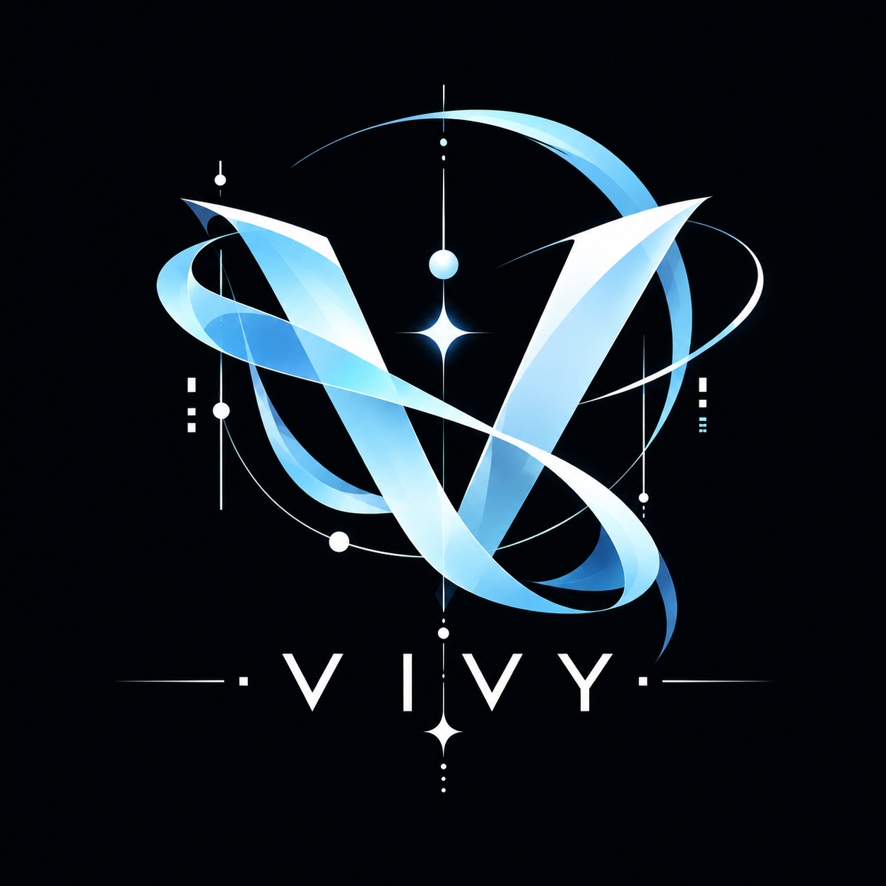
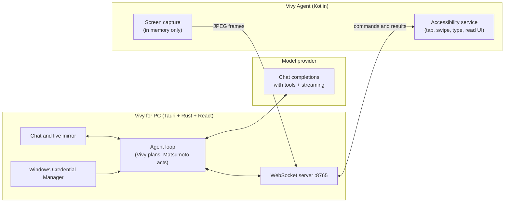

<p align="center">
  
</p>

<h1 align="center">Vivy</h1>

<p align="center"><b>An AI that uses your Android phone for you.</b><br/>
Tell Vivy what you want in plain words. She plans it, her helper Matsumoto taps through it, and you watch it happen live on your PC.</p>

<p align="center">
  
  
  
  
</p>

---

## What it does

Vivy is two apps that work together:

- **Vivy for PC** (`Vivy.exe`): a desktop app with a chat, a live mirror of your phone screen, and the AI agent itself.
- **Vivy Agent for Android**: a small app that streams your screen to the PC and carries out taps, swipes and typing through Android's Accessibility service. No root, no USB cable, no `adb`.

You type something like *"Open YouTube and search for lo-fi music"*. Vivy reads the screen, decides what to do, and Matsumoto (the little cube) performs each step on the phone: opening apps, tapping buttons by their label, scrolling, typing, and checking the result before moving on.

### Highlights

- **Wireless and rootless.** Phone and PC talk over your local Wi-Fi.
- **Live screen mirror.** Frames stream in memory only; nothing is recorded or saved.
- **Reads the screen as text first.** It uses the accessibility tree to tap elements by name, and falls back to looking at pixels only for games, maps and other canvas-drawn apps.
- **You stay in control.**
  - A global **Stop** hotkey (`Ctrl+Shift+X`) works even when the window isn't focused.
  - **Pause** lets you use the phone yourself, then resume.
  - An agent on/off switch.
  - Permission prompts before sensitive or destructive actions.
- **Live thinking.** Reasoning and replies stream in as the model writes them.
- **Chats with memory.** Each chat remembers what was said and done. Long chats are summarized automatically so they stay within the model's limits.
- **Resend, retry and edit** any earlier message. Everything after it is replaced.
- **Pick your provider**: AICredits, OpenAI, Anthropic, Google Gemini, or any OpenAI-compatible endpoint.
- **Keys stay local.** They are stored in Windows Credential Manager, never in plain-text files.

---

## Supported providers

All providers are used through the OpenAI-compatible chat-completions API. The suggested models are mostly mid-tier: strong enough for multi-step phone tasks, without flagship prices. Each provider also lists its top model for complex tasks. All of them accept images and support tool calling.

| Provider | Everyday models | For complex tasks | Get a key |
|---|---|---|---|
| **AICredits** (default, one key for many models) | `z-ai/glm-5.3-flash`, `anthropic/claude-haiku-5.5`, `openai/gpt-6-luna`, `deepseek/deepseek-v4.1-flash`, `moonshotai/kimi-k2.6` | `anthropic/claude-opus-5.5` | [aicredits.in](https://aicredits.in) |
| **OpenAI** | `gpt-6.1-sol`, `gpt-6-luna`, `gpt-5-mini` | `gpt-6-astra` | [platform.openai.com](https://platform.openai.com/api-keys) |
| **Anthropic** | `claude-sonnet-5-5`, `claude-sonnet-5`, `claude-haiku-5-5` | `claude-opus-5-5` | [console.anthropic.com](https://console.anthropic.com/settings/keys) |
| **Google Gemini** | `gemini-3.8-flash`, `gemini-3.6-flash`, `gemini-3.5-flash-lite` | `gemini-4-argon` | [aistudio.google.com](https://aistudio.google.com/apikey) |
| **Custom** | Any model ID | | OpenRouter, a local server, or any OpenAI-compatible URL |

You can type any other model ID in Settings. It just needs to accept images and support tool calling.

**Thinking.** Vivy shows the model's reasoning live when the provider sends it, and lets you set a thinking effort (Default, Low, Medium, High) where the provider supports it:

| Provider | Live thinking | Effort setting |
|---|---|---|
| AICredits | Yes, for models that reason | Yes |
| Google Gemini | Yes, as thought summaries | Yes |
| OpenAI | No: OpenAI doesn't return reasoning on this API | Yes |
| Anthropic | No: Claude's thinking isn't returned on this API | No: Claude decides on its own |
| Custom | If the endpoint sends it | No |

Web search during tasks is optional and uses [Tavily](https://tavily.com).

---

## Getting started

### 1. Install

Build both apps from source (see [Building from source](#building-from-source)), or use the binaries from the Releases page if one is published.

### 2. Set up the PC app

1. Open **Vivy**.
2. Click **Settings**, choose a **provider**, and paste your API key.
3. Optionally add a Tavily key for web search.

### 3. Set up the phone app

1. Install **Vivy Agent** on your phone.
2. Turn on **Accessibility** for Vivy Agent when the app asks.
3. Allow **screen sharing**.
4. Enter the address and the **pairing code** shown in the PC app (for example `192.168.1.20` and `7KQ4-M2XD-9HPA`) and tap **Pair**. You only pair once; after that, just tap **Connect**.

Both devices must be on the same network. Over USB, you can instead run `adb reverse tcp:8765 tcp:8765` and connect to `127.0.0.1`.

### 4. Ask for something

```
Open YouTube and search for lo-fi music
Turn on Wi-Fi from quick settings
What's on my screen right now?
```

> **Tip:** Some phones (Xiaomi, Oppo, Vivo, Samsung and others) stop background services to save battery. If Android says the accessibility service is *not working*, set Vivy Agent's battery usage to **Unrestricted** and allow **Autostart**.

---

## How it works



1. Your message and the chat's memory go to the model, together with the list of tools Matsumoto can use.
2. The model answers in text or calls tools such as `inspect_screen`, `tap_element`, `open_app` or `type_text`.
3. The PC sends each command to the phone over the WebSocket, waits for the result, and feeds it back to the model.
4. The loop continues until the task is finished, you stop it, or a safety limit is reached.

The message format between PC and phone is documented in [docs/PROTOCOL.md](docs/PROTOCOL.md).

---

## Privacy and safety

| | |
|---|---|
| **Screen frames** | Streamed in memory and never written to disk on either device. |
| **API keys** | Stored in Windows Credential Manager. They are sent only to the provider you choose. |
| **Chats** | Saved locally in `%LOCALAPPDATA%\Vivy\sessions` so you can reopen them. Delete a chat from the sidebar to remove it. |
| **Sensitive actions** | Reading photos, files, messages or email requires your OK. Deleting things and payments ask every time. |
| **Stopping** | `Esc` in the window, `Ctrl+Shift+X` from anywhere, or the agent switch in the top bar. |

**Secure pairing.** The PC and phone pair once with a one-time code, and from then on only that phone can connect to that PC:

- Everything between them (screen frames and commands) is encrypted with TLS.
- During pairing, both sides prove they know the code, tied to the PC's certificate, so another device on the network can't pose as either one.
- After pairing, the phone pins the PC's certificate and proves itself with a secret token. Any other connection is dropped before it receives anything.
- Codes are 12 characters, expire after 5 minutes, and stop working after 5 wrong tries.
- **Forget phone** on the PC (or **Forget this PC** on the phone) undoes the pairing.

---

## Building from source

### Requirements

- **PC:** Windows 10 or 11, [Rust](https://rustup.rs) (stable), [Node.js](https://nodejs.org) 18+.
- **Android:** Android Studio, or a JDK 17+ with the Android SDK. Phones need Android 7.0 or later for full gesture control.

### PC app

```bash
cd desktop
npm install
npm run tauri dev      # run with hot reload
npm run tauri build    # build Vivy.exe and the installers
```

The output goes to `desktop/src-tauri/target/release/` (the exe) and `.../bundle/` (MSI and setup installers).

### Android app

```bash
cd android
./gradlew assembleRelease
```

Release builds are signed with your own key if `android/keystore.properties` exists (copy [`keystore.properties.example`](android/keystore.properties.example)). Otherwise they use the Android debug key, which works fine for personal use.

### Both at once

```powershell
powershell -ExecutionPolicy Bypass -File scripts/build_and_package.ps1
```

This builds both apps and copies them to `releases/`, which is gitignored.

### Tests

```bash
cd desktop/src-tauri
cargo test
```

---

## Project layout

```
desktop/                 PC app
  src/                   React UI (chat, mirror, settings, Matsumoto)
  src-tauri/src/
    agent/               agent loop, tools, vision, memory, permissions
    phone/               WebSocket server and phone protocol
    security/            credential storage and provider settings
    sessions.rs          saved chats
android/                 phone app (Kotlin, Jetpack Compose)
  app/src/main/java/com/vivy/agent/
    service/             accessibility control and screen capture
    network/             WebSocket client
docs/                    protocol and setup guides
scripts/                 build and packaging script
```

---

## About the name

**Vivy** is the name of this project's assistant, and **Matsumoto** is the name of her helper, the cube that carries out each action. The names are a nod to *Vivy: Fluorite Eye's Song*, a story about an AI working alongside a helper AI to make people's lives better, which is what this project tries to do on a smaller scale.

Only the names are referenced. The project contains no artwork, music, dialogue, character designs or other material from the anime: the cube, the icon and all other assets were made for this project. Vivy is an independent open-source project and is not affiliated with or endorsed by the anime's creators or rights holders.

---

## License

[MIT](LICENSE). Use it, change it, share it.
